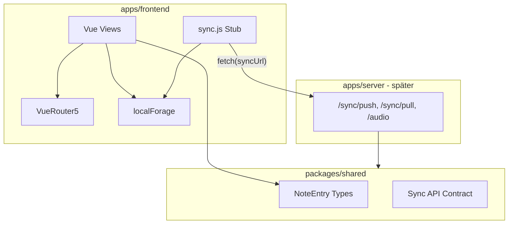

# JW Notes — Entwicklungsplan (Vue Router 5)

Ziel: Die App langfristig betreiben, Funktionsumfang moderat erweitern, Wartungsaufwand gering halten.

---

## Änderung gegenüber vorherigem Plan

**Vue Router 4 → Vue Router 5** als Zielversion für die Vite-Migration.

Begründung:

- Aktuelle Hauptlinie; Nuxt 4 nutzt ebenfalls Router 5
- Keine Breaking Changes bei manuellen Routen (wie in JW Notes heute)
- Optional später: file-based routing über `vue-router/vite` (Ersatz für Nuxt `pages/`) ohne extra Paket `unplugin-vue-router`

---

## Ist-Zustand (erledigt)

- Monorepo mit npm workspaces: [`package.json`](../package.json)
- Frontend unter [`apps/frontend/`](../apps/frontend/) (noch **Nuxt 3 + Vuetify**)
- `vue-router@^4.5.0` in [`apps/frontend/package.json`](../apps/frontend/package.json) (Nuxt-gebunden)
- Platzhalter [`packages/.gitkeep`](../packages/.gitkeep)
- CI: [`.github/workflows/nuxtjs.yml`](../.github/workflows/nuxtjs.yml) baut `@jw-notes/frontend` für GitHub Pages (`baseURL: /jw-notes/`)

---

## Architektur-Entscheidungen

### Stack (Ziel)

| Komponente | Entscheidung | Begründung |
|---|---|---|
| Framework | **Vite + Vue 3 + Vue Router 5** | SSR nicht genutzt; Router 5 = aktuelle Linie, kein API-Umbruch bei manuellen Routen |
| Routing | **Manuell (`createRouter`)** | 4 Routen; gleiche Patterns wie heute (`$router`, `<router-link>`) |
| UI | **Eigenes CSS + w3.css** | Vuetify nur für `v-app` + `v-textarea` genutzt |
| Lokaler Speicher | **localForage** | IndexedDB-Backend, Blob-Support (Audio) |
| Dexie | **Nein (vorerst)** | Kein relationaler Query-Bedarf |
| React-Umstieg | **Nein** | Kleine Codebasis; Rewrite unnötig |
| Nuxt / Vuetify | **Entfernen** | Weder für Roadmap noch für Sync nötig |

### Vue Router 5 — relevante Unterschiede zu v4 (für dieses Projekt)

| Bereich | Auswirkung auf JW Notes |
|---|---|
| Manuelle Routen (`createRouter`) | **Kein Code-Unterschied** |
| `$router` / `$route` / `<router-link>` | **Unverändert** |
| File-based routing (`vue-router/vite`) | Optional später; ersetzt Nuxt `pages/` |
| CDN/IIFE-Build | Nicht relevant (Vite/npm) |

Geplante Dependency in Phase 2:

```json
"vue-router": "^5.1.0"
```

### Monorepo (Zielstruktur)

```
jw-notes/
├── apps/
│   ├── frontend/     # Vite + Vue + Vue Router 5
│   └── server/       # später
├── packages/
│   └── shared/
├── plan/
│   └── roadmap.md
└── package.json
```

### Architektur-Diagramm



---

## Themes (Hell, OLED, Dark)

CSS Custom Properties statt Vuetify-Theme:

- **oled:** `#000000`
- **dark:** `#121212`
- **light:** `#f5f5f5`

Umschaltung via `document.documentElement.dataset.theme` + Speicherung in Options (`localForage`).

Bestehende Klassen in [`apps/frontend/assets/default.css`](../apps/frontend/assets/default.css) (`.theme-background`, `.theme-color`) auf CSS-Variablen umstellen.

---

## Datenspeicher & Modell

### localForage-Keys

| Key | Inhalt |
|---|---|
| `DB` | Notizen-Metadaten (JSON) |
| `options` | Theme, Schriftgröße, Bibel-URL, Sync-URL, Token |
| `audio:{id}` | Audio-Blobs (getrennt vom JSON) |

### Datenmodell (Ziel)

```js
{
  id: "uuid",
  title: "...",
  date: 1234567890,
  notes: [{ type, content, reactions, audioTimestamp, collapsed, annotations }],
  audioId: "abc123",
  updatedAt: "ISO-8601",
  revision: 1,
  syncStatus: "synced" | "pending" | "conflict"
}
```

### Migration von localStorage

Einmalig beim App-Start: `localStorage` → localForage, alte Keys entfernen.

`window.jsonDB` ersetzen durch [`apps/frontend/stores/default.js`](../apps/frontend/stores/default.js) → `src/lib/storage.js`.

---

## Sync (Offline-first)

- Lokal = Wahrheit; Server = Backup + Geräte-Sync
- Sync-URL konfigurierbar in Optionen
- Konfliktstrategie (Start): Last-Write-Wins (`updatedAt`)
- API-Client-Stub: `pushChanges()` / `pullChanges()` vor `apps/server/`
- Audio-Sync: separate Endpunkte, nicht im JSON-Blob
- Vertrag in [`packages/shared/`](../packages/shared/)

---

## Geplante Features (Roadmap)

Keines erfordert Nuxt oder Vuetify:

| Feature | Technik |
|---|---|
| Bibelbücher einklappen | Vue-State + Accordion / `<details>` |
| Reihenfolge ändern | `vue-draggable-plus` oder SortableJS |
| Notizen zu Bibeltexten/Videos | Erweitertes Datenmodell |
| Programmpunkte-Übersicht | Neue View + Route (Header in [`compHeader.vue`](../apps/frontend/components/compHeader.vue) aufräumen) |
| Audio markieren / Transkription | MediaRecorder, localForage Blobs |
| Doppelaufnahme | Sequenzielles/zweites Recording |
| Zeitstempel bei Audioeingabe | Sync Textzeile ↔ `audio.currentTime` |
| Nächsten Vers laden | Erweiterung bestehender `fetch`-Logik |
| Markierungen in Bibeltexten | Annotierte Spans + Links |
| Emojis an Nachrichten | Emoji-Picker + Reaktions-Array (⭐❓🎥 existieren bereits) |
| Fortlaufende Verse | Auto-Vervollständigung / Parsing |

Optionale Libraries: `@vueuse/core`, `vue-draggable-plus`, `emoji-picker-element`, `vite-plugin-pwa`.

---

## Migrationsphasen

### Phase 1 — Monorepo (erledigt)

Frontend nach `apps/frontend`, Root-Workspaces, CI angepasst.

### Phase 2 — Vite-Migration (Vue Router 5)

- Nuxt entfernen, **Vite + Vue 3 + Vue Router 5** einrichten
- Router manuell definieren in `src/router/index.ts` (Routen-Namen beibehalten: `Main`, `OverviewNotes`, `EditorNotes`, `Options` — benötigt für [`compHeader.vue`](../apps/frontend/components/compHeader.vue))
- Vuetify entfernen (`v-textarea` → natives `<textarea>`, kein `v-app`)
- Struktur: `src/views/`, `src/components/`, `src/router/`, `src/lib/`
- `base: '/jw-notes/'` in `vite.config.ts`
- GitHub Pages: `404.html` = Kopie von `index.html`
- CI auf `vite build` umstellen
- Dependencies: `vue-router@^5.1.0`, Nuxt/Vuetify/`@mdi/font` entfernen

Beispiel Router-Setup (unverändert zu v4-API):

```js
import { createRouter, createWebHistory } from 'vue-router'

export default createRouter({
  history: createWebHistory('/jw-notes/'),
  routes: [
    { path: '/', name: 'Main', component: () => import('../views/IndexView.vue') },
    { path: '/overview/notes', name: 'OverviewNotes', component: () => import('../views/OverviewNotesView.vue') },
    { path: '/editor/notes/:idNotes', name: 'EditorNotes', component: () => import('../views/EditorNotesView.vue') },
    { path: '/options', name: 'Options', component: () => import('../views/OptionsView.vue') },
  ],
})
```

Optional später (nicht Phase 2): Umstieg auf file-based routing via `vue-router/vite`, analog zu bisherigem `pages/`-Ordner.

### Phase 3 — localForage + Datenmodell

- `src/lib/storage.js` mit localForage-Instanz
- UUIDs, `updatedAt`, `revision` einführen
- localStorage-Migration
- `window.jsonDB` entfernen

### Phase 4 — Themes

- CSS-Variablen für oled / dark / light
- Theme-Auswahl in Optionen

### Phase 5 — Features schrittweise

Reihenfolge empfohlen: Accordion → Drag & Drop → Emojis → Bibel-Erweiterungen → Audio

### Phase 6 — Backend & Sync

- `packages/shared` mit API-Typen
- `apps/server` (Sprache frei wählbar)
- Sync-Stub durch echte Implementierung ersetzen
- Sync-UI in Optionen

---

## Was bewusst weggelassen wird

- Pinia (Mini-Store reicht vorerst)
- Dexie (localForage genügt)
- File-based routing in Phase 2 (manuell reicht; v5-Option bleibt offen)
- TypeScript überall (schrittweise möglich)
- PWA (erst bei Bedarf für Offline-Versammlungen)

---

## Risiken & Hinweise

- **Nuxt 3 EOL:** 31.07.2026 — Phase 2 zeitnah angehen
- **Router 5:** Kein Runtime-Risiko bei manuellen Routen; Peer-Dependency `vue@^3.5.34` beachten
- **Audio + Sync:** LocalStorage-Limit (~5 MB) — localForage/IndexedDB zwingend vor Audio-Feature
- **Programm-Routen:** Verwaiste Referenzen in [`compHeader.vue`](../apps/frontend/components/compHeader.vue) bei Aufräumen entfernen
